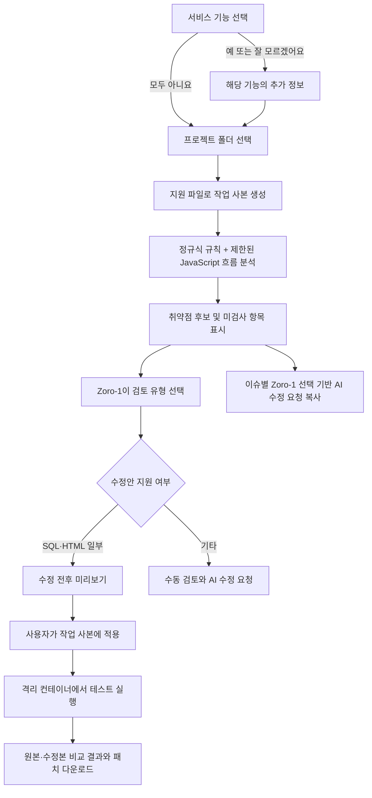

# Trace 보안 진단 워크플로우와 구현 현황

기준일: 2026-11-19. 이 문서는 `sites/zoro-security-demo`의 로컬 브라우저 데모를 기준으로 합니다. SonarQube의 검사 → 검토 → 수정 → 재검증 흐름을 참고했으며 별도의 SonarQube 서버를 호출하지 않습니다.

## 판단 순서

1. **서비스 기능**. 로그인, 비공개 정보, 방문자 입력 중 예 또는 잘 모르겠어요를 선택한 기능에 한해 로그인 방식, 공개 범위, 입력 종류를 묻습니다.
2. **입력과 범위**. 브라우저에서 웹 주소나 폴더를 지정합니다. 공개 HTML과 지원 소스에서 설문에 대응하는 단서를 수집한 뒤 Zoro-1이 점검 방식을 선택합니다. 선택된 코드와 지원하는 테스트·패키지 파일로 메모리 작업 사본을 만듭니다. 비밀 파일과 의존성 폴더를 제외하고 최대 200개 파일, 파일당 300KB, 전체 3MB를 적용합니다.
3. **정적 탐지**. 정규식 규칙을 적용하고 지원되는 JavaScript 파일에 제한된 AST 흐름 분석을 수행합니다. `req`/`request` 입력이 HTML 삽입·SQL 문자열·셸 명령·서버 요청 주소·`eval`에 도달하는 후보를 찾습니다. 같은 파일의 일부 함수 인자와 반환값, `if` 분기를 추적합니다. 이름이 정제·검증 함수처럼 보이면 호출 사실을 기록합니다.
4. **결과 표시**. 위치, 후보 CWE, WSTG 매핑이 있는 경우 해당 ID, 권장 조치와 분석 범위를 표시합니다. 후보와 실제 악용 확인을 구별합니다. 체크리스트에서 미검사 항목은 미검사로 남습니다. npm 잠금 파일에 대해서는 사용자가 요청하면 OSV 대조를 수행합니다. 그 외 결과의 CVE는 미확인입니다.
5. **추가 검토 선택**. Zoro-1은 탐지 유형과 사용자 진술에 따라 SQL·HTML 수정안 검토, 동적 코드 실행·요청 주소 수동 검토, 보류 중 허용된 한 가지를 선택합니다. 탐지는 모델을 호출하기 전에 실행됩니다.
6. **수정 제안**. 지원되는 단순 HTML 대입 또는 `pg`/`mysql2` 쿼리에 한해 AST 기반 수정 전후를 표시합니다. 그 외에는 수동 검토 안내가 나옵니다. 이슈별 AI 수정 요청에는 Zoro-1의 선택과 정적 규칙의 조치, 확인된 위치·수정안이 반영됩니다.
7. **적용과 재검증**. 사용자가 검토 후 작업 사본에만 수정안을 적용합니다. 원본 반영용 패치를 내려받을 수 있습니다. 사용자가 테스트 명령과 회귀 테스트를 선택하면 네트워크가 차단된 Docker 컨테이너에서 원본과 수정본을 따로 실행합니다. 같은 테스트 단언의 실패 → 통과 및 동일 정적 규칙 결과를 표시합니다.

## 현재 구현과 추가 구현 구분

| 단계 | 현재 구현 | 추가 구현이 필요한 부분 |
|---|---|---|
| 프로젝트 입력 | 폴더 선택, 지원 파일 전체, 크기 제한, 세션별 스냅샷 | 대규모 프로젝트, 더 다양한 파일 형식·패키지 매니저와 전체 의존 파일 처리 |
| 규칙 탐지 | 자체 패턴 규칙과 JavaScript AST 후보 | 언어·프레임워크별 규칙 확장, 룰 버전 관리, 정밀도·재현율 검증 |
| 코드 흐름 | 동일 파일의 제한된 함수 호출·반환, `if` 분기, 정제 이름 호출 표시 | 파일 간 호출, 메서드·동적 호출, 반복문, 타입 분석, 경로 실행 가능성과 정제 효과 검증 |
| Zoro-1 판단 | 허용된 선택지 중 다음 검토 선택 | 실제 코드 흐름 근거를 활용한 검토 확대, 항목별 선택과 검증 결과의 체계적인 평가 |
| 수정 제안 | 제한된 HTML/SQL 변경, 기타 규칙의 간단한 수정 요청문 | 동적 코드 실행·SSRF 등 실제 코드에 맞는 수정안, 환경·프레임워크 호환성 검사 |
| 재검증 | 명시적으로 선택한 Node 테스트의 수정 전후 비교, 격리 실행 | 다양한 테스트 프레임워크·언어, 실제 DB·브라우저·서비스의 보안 회귀 검증 |
| 의존성 | 공식 npm 레지스트리와 lockfile v2/v3 기반 패키지를 무결성 확인 후 오프라인 설치 | 사설 레지스트리, workspace, 다른 생태계, 설치 스크립트가 필요한 패키지. npm 잠금 파일의 OSV 대조 지원. 다른 생태계 CVE/SCA는 미구현 |
| 이슈 관리 | 결과 목록, 상세, CSV | 결과 영속화, 재검사 간 동일 이슈 추적, 담당자·승인·위험 수용 이력 |
| 품질 게이트 | `판정 보류` 표시 | 검증 가능한 정책, 실패 기준과 CI/PR 연동 |
| 배포·운영 | 로컬 데모와 Brev 포트 포워딩 | 다중 사용자 인증, 실행 격리 운영, 배포와 권한·데이터 수명 관리 |

## 실습 사례와 평가

- **NodeGoat 실습 코드 2개 파일, 알려진 위치 4곳**. 기존 정규식은 0/4, 확장된 흐름 규칙은 4/4를 후보로 표시했습니다. 이는 해당 위치의 탐지 비교이며 오탐률이나 전체 프로젝트 성능은 측정하지 않았습니다.
- **실제 Zoro-1의 선택**. `contributions.js`에서 동적 코드 실행 수동 검토, `research.js`에서 서버 요청 주소 수동 검토를 선택했습니다. 모델이 기존 탐지 전에 새로운 후보를 생성하지 않으므로 이 실험은 Zoro-1의 탐지율 향상을 입증하지 않습니다.
- **수동 수정 비교**. Zoro-1이 선택한 `contributions.js`를 대상으로 사람이 작성한 `eval → Number` 비교안과 테스트 스텁을 격리 컨테이너에서 실행했습니다. 선택한 테스트가 수정 전 실패, 수정 후 통과했습니다. 모델이 수정안을 생성한 것은 아니며 전체 애플리케이션과 SSRF 수정 검증은 수행하지 않았습니다.
- **합성 선택 비교**. 네 사례에서 HTML 우선 고정 기준선과 Zoro-1 모두 지원 가능한 수정안 4/4를 선택했습니다. 이 범위에서는 관측된 차이가 없습니다.

재현 스크립트는 `evaluate-nodegoat.mjs`, `evaluate-zoro.mjs`입니다. NodeGoat 실습 이미지와 스크립트 실행 방법은 [README.md](README.md)를 참고하세요. 모델 서버가 반환하는 revision은 서버의 자기 보고입니다.

## 초보 바이브코더를 위한 핵심 다섯 범주

접근 제어, 비밀정보 노출, 인증·세션, 인젝션·XSS, 취약한 의존성을 우선 검사 범주로 표시합니다. 각 카드의 검증 절차는 HTML·SQL 일부의 격리 테스트와 npm OSV 대조를 제외하면 수동 확인 항목입니다. 접근 정책과 계정 간 동적 검증, 실제 자격 증명 유효성, 운영 쿠키·토큰 검증은 아직 미구현입니다. npm 잠금 파일이 있으면 OSV 대조를 자동 실행하며 패키지 이름·버전을 OSV에 보냅니다.

## 프로젝트 선택, 링크 점검과 위험도

프로젝트 화면은 설문·대상 선택, 분석 결과, AI 수정 요청, 수정 후 재점검의 단계로 구성된다. 로그인, 비공개 데이터와 사용자 입력 기능을 선택한 후 공개 링크 응답만 확인하거나 로컬 소스를 함께 선택한다. 링크가 없는 로컬 코드 검사도 가능하다. Zoro-1의 응답과 설정된 리비전 일치 여부를 확인하며, 고급 검토를 모델이 선택하고 사용자가 명시한 127.0.0.1 테스트 서버 주소가 있을 때만 주소를 채운다. 경로·계정·인증 정보는 추정하지 않는다.

링크 검사는 DNS가 공개 IPv4로 확인된 HTTP(S) 도메인에 쿠키나 인증 없이 HEAD 한 번을 보내 응답 헤더만 확인한다. 내부·예약 주소, IP 직접 입력, 인증정보·쿼리, 비표준 포트를 거부하고 확인된 주소로 연결하며 리디렉션을 따르지 않는다. 헤더 누락은 검토 후보이며 응답 상태·검사 한계를 함께 표시한다. 로그인, 코드, 권한 및 실제 악용은 검사하지 않는다.

npm 잠금 파일은 OSV에 패키지 이름과 버전을 대조한다.

## 수정 요청과 재점검 화면

코드 비교는 검사한 위치와 확인된 수정 제안을 표시하며 비밀정보가 포함될 수 있는 줄은 숨긴다. 코드 비교에서 Zoro-1 직접 수정을 열 수 있고, 분석 결과의 AI 수정 요청 버튼에서 수정 프롬프트를 만들 수 있다. 링크 전용 결과는 코드 위치를 추정하지 않는다.

수정 요청 단계는 경고별 파일·줄과 확인된 수정안, 검증 방법을 기반으로 모델이 선택한 순서로 문장을 만든다. 링크 응답에는 파일 위치를 알 수 없다고 명시하고 서버 설정을 찾도록 안내한다. 이 요청만으로 수정 성공이나 안전을 보장하지 않으며 실행과 재점검이 필요하다. CWE와 수정 프롬프트 탭은 현재 검사 결과를 사용한다.

수동 수정 후 STEP 4에서 완료 여부를 확인하면 처음 선택한 링크·폴더·범위로 다시 점검한다. 직접 적용은 전체 변경을 한 번 승인해 저장한 뒤 같은 재점검을 자동으로 수행한다. 후보가 남으면 분석 결과로 돌아가며, 기존 링크·폴더·범위 또는 파일이 빠지거나 OSV 대조가 실패한 경우 완료하지 않는다. 점검한 범위에서 후보가 없을 때의 완료 화면은 미검사 영역과 실제 악용 여부에 대한 한계를 표시한다. 같은 폴더 이름과 파일 목록만으로 동일 프로젝트를 증명하지 못한다.
